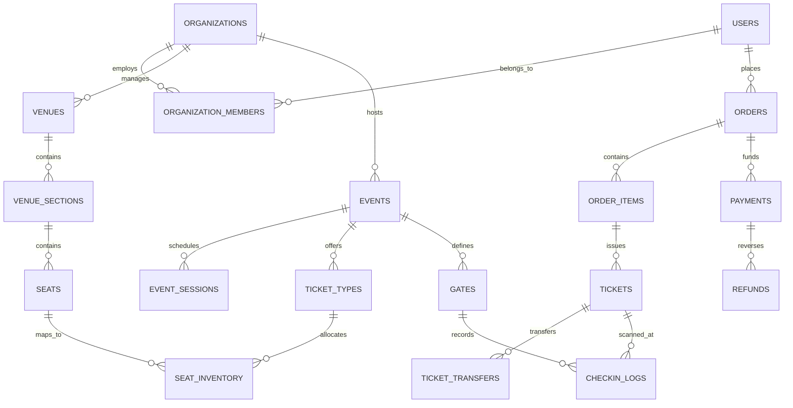

# EventPulse — Relational Database Design & Schema Specification

**Document Version:** 1.0.0  
**Database Target:** PostgreSQL 16+  
**Naming Standard:** `snake_case` tables & columns, UUIDv7 primary keys, explicit foreign keys & indexes  

---

## 1. Schema Overview & Normalization Strategy

The schema is structured into distinct functional domains with clear relational integrity:
1. **Identity & Multi-Tenancy:** `users`, `roles`, `permissions`, `organizations`, `organization_members`.
2. **Venues & Physical Seating:** `venues`, `venue_sections`, `seats`.
3. **Events & Commercial Catalog:** `events`, `event_sessions`, `ticket_types`, `promotions`, `coupons`.
4. **Inventory & High-Concurrency Holds:** `seat_inventory`, `seat_holds`.
5. **Commerce & Orders:** `orders`, `order_items`, `idempotency_keys`.
6. **Financials & Settlements:** `payments`, `refunds`.
7. **Digital Ticketing & Transfers:** `tickets`, `ticket_transfers`.
8. **Field Operations & Access Control:** `gates`, `gate_staff_assignments`, `checkin_logs`.
9. **Engagement & Operations Telemetry:** `favorites`, `reviews`, `waitlist_entries`, `notifications`, `audit_logs`.

---

## 2. Entity Relationship Diagram (ERD)



---

## 3. Detailed Table Specifications & DDL

### 3.1 Identity & Multi-Tenancy

```sql
-- Users table: Attendants, Organizers, and Admins
CREATE TABLE users (
    id UUID PRIMARY KEY DEFAULT gen_random_uuid(),
    email VARCHAR(255) NOT NULL UNIQUE,
    password_hash VARCHAR(255) NOT NULL,
    full_name VARCHAR(128) NOT NULL,
    phone_number VARCHAR(32),
    avatar_url VARCHAR(512),
    role VARCHAR(32) NOT NULL DEFAULT 'CUSTOMER', -- 'CUSTOMER', 'ORGANIZER', 'PLATFORM_ADMIN'
    is_active BOOLEAN NOT NULL DEFAULT TRUE,
    is_verified BOOLEAN NOT NULL DEFAULT FALSE,
    notification_preferences JSONB NOT NULL DEFAULT '{"email": true, "sms": true, "push": true}',
    created_at TIMESTAMP WITH TIME ZONE NOT NULL DEFAULT NOW(),
    updated_at TIMESTAMP WITH TIME ZONE NOT NULL DEFAULT NOW()
);
CREATE INDEX idx_users_email ON users(email);

-- Organizations: Multi-tenant business entities
CREATE TABLE organizations (
    id UUID PRIMARY KEY DEFAULT gen_random_uuid(),
    name VARCHAR(255) NOT NULL,
    slug VARCHAR(255) NOT NULL UNIQUE,
    logo_url VARCHAR(512),
    website VARCHAR(255),
    tax_identifier VARCHAR(64), -- GSTIN / VAT
    billing_email VARCHAR(255) NOT NULL,
    payout_bank_account_details JSONB,
    verification_status VARCHAR(32) NOT NULL DEFAULT 'PENDING', -- 'PENDING', 'VERIFIED', 'REJECTED'
    created_at TIMESTAMP WITH TIME ZONE NOT NULL DEFAULT NOW(),
    updated_at TIMESTAMP WITH TIME ZONE NOT NULL DEFAULT NOW()
);
CREATE INDEX idx_organizations_slug ON organizations(slug);

-- Organization Members: Team RBAC
CREATE TABLE organization_members (
    id UUID PRIMARY KEY DEFAULT gen_random_uuid(),
    organization_id UUID NOT NULL REFERENCES organizations(id) ON DELETE CASCADE,
    user_id UUID NOT NULL REFERENCES users(id) ON DELETE CASCADE,
    org_role VARCHAR(32) NOT NULL, -- 'OWNER', 'ADMIN', 'EVENT_MANAGER', 'FINANCE', 'CHECKIN_STAFF'
    created_at TIMESTAMP WITH TIME ZONE NOT NULL DEFAULT NOW(),
    updated_at TIMESTAMP WITH TIME ZONE NOT NULL DEFAULT NOW(),
    CONSTRAINT uq_org_user UNIQUE (organization_id, user_id)
);
CREATE INDEX idx_org_members_user ON organization_members(user_id);
```

### 3.2 Venues & Seating Layouts

```sql
CREATE TABLE venues (
    id UUID PRIMARY KEY DEFAULT gen_random_uuid(),
    organization_id UUID NOT NULL REFERENCES organizations(id),
    name VARCHAR(255) NOT NULL,
    address_line1 VARCHAR(255) NOT NULL,
    address_line2 VARCHAR(255),
    city VARCHAR(100) NOT NULL,
    state VARCHAR(100) NOT NULL,
    country VARCHAR(100) NOT NULL,
    postal_code VARCHAR(32) NOT NULL,
    latitude NUMERIC(10, 7),
    longitude NUMERIC(10, 7),
    total_capacity INTEGER NOT NULL,
    layout_type VARCHAR(32) NOT NULL DEFAULT 'RESERVED', -- 'GENERAL_ADMISSION', 'RESERVED', 'HYBRID'
    created_at TIMESTAMP WITH TIME ZONE NOT NULL DEFAULT NOW(),
    updated_at TIMESTAMP WITH TIME ZONE NOT NULL DEFAULT NOW()
);
CREATE INDEX idx_venues_city ON venues(city);

CREATE TABLE venue_sections (
    id UUID PRIMARY KEY DEFAULT gen_random_uuid(),
    venue_id UUID NOT NULL REFERENCES venues(id) ON DELETE CASCADE,
    name VARCHAR(128) NOT NULL, -- e.g., 'Grandstand East', 'Floor Pit', 'VIP Mezzanine'
    section_code VARCHAR(32) NOT NULL,
    capacity INTEGER NOT NULL,
    is_general_admission BOOLEAN NOT NULL DEFAULT FALSE,
    display_order INTEGER NOT NULL DEFAULT 0,
    created_at TIMESTAMP WITH TIME ZONE NOT NULL DEFAULT NOW()
);
CREATE INDEX idx_sections_venue ON venue_sections(venue_id);

CREATE TABLE seats (
    id UUID PRIMARY KEY DEFAULT gen_random_uuid(),
    section_id UUID NOT NULL REFERENCES venue_sections(id) ON DELETE CASCADE,
    row_label VARCHAR(16) NOT NULL, -- e.g., 'A', '12'
    seat_number VARCHAR(16) NOT NULL, -- e.g., '101'
    is_accessible BOOLEAN NOT NULL DEFAULT FALSE, -- ADA wheelchair compliance
    is_companion BOOLEAN NOT NULL DEFAULT FALSE,
    grid_x INTEGER, -- Canvas / SVG X coordinate
    grid_y INTEGER, -- Canvas / SVG Y coordinate
    CONSTRAINT uq_section_row_seat UNIQUE (section_id, row_label, seat_number)
);
CREATE INDEX idx_seats_section ON seats(section_id);
```

### 3.3 Events & Commercial Catalog

```sql
CREATE TABLE events (
    id UUID PRIMARY KEY DEFAULT gen_random_uuid(),
    organization_id UUID NOT NULL REFERENCES organizations(id),
    venue_id UUID NOT NULL REFERENCES venues(id),
    title VARCHAR(255) NOT NULL,
    slug VARCHAR(255) NOT NULL UNIQUE,
    short_summary VARCHAR(512) NOT NULL,
    description TEXT NOT NULL,
    category VARCHAR(64) NOT NULL, -- 'CONCERT', 'CONFERENCE', 'THEATRE', 'SPORTS', 'COMEDY'
    banner_url VARCHAR(512),
    thumbnail_url VARCHAR(512),
    status VARCHAR(32) NOT NULL DEFAULT 'DRAFT', -- 'DRAFT', 'PUBLISHED', 'SALES_OPEN', 'SOLD_OUT', 'CANCELLED', 'COMPLETED'
    age_restriction VARCHAR(32) DEFAULT 'ALL_AGES',
    is_featured BOOLEAN NOT NULL DEFAULT FALSE,
    requires_virtual_queue BOOLEAN NOT NULL DEFAULT FALSE,
    max_tickets_per_user INTEGER NOT NULL DEFAULT 6,
    cancellation_reason TEXT,
    created_at TIMESTAMP WITH TIME ZONE NOT NULL DEFAULT NOW(),
    updated_at TIMESTAMP WITH TIME ZONE NOT NULL DEFAULT NOW()
);
CREATE INDEX idx_events_status_category ON events(status, category);
CREATE INDEX idx_events_slug ON events(slug);

CREATE TABLE event_sessions (
    id UUID PRIMARY KEY DEFAULT gen_random_uuid(),
    event_id UUID NOT NULL REFERENCES events(id) ON DELETE CASCADE,
    session_title VARCHAR(128) NOT NULL,
    doors_open_at TIMESTAMP WITH TIME ZONE NOT NULL,
    starts_at TIMESTAMP WITH TIME ZONE NOT NULL,
    ends_at TIMESTAMP WITH TIME ZONE NOT NULL,
    created_at TIMESTAMP WITH TIME ZONE NOT NULL DEFAULT NOW()
);
CREATE INDEX idx_sessions_event_dates ON event_sessions(event_id, starts_at);

CREATE TABLE ticket_types (
    id UUID PRIMARY KEY DEFAULT gen_random_uuid(),
    event_id UUID NOT NULL REFERENCES events(id) ON DELETE CASCADE,
    section_id UUID REFERENCES venue_sections(id),
    name VARCHAR(128) NOT NULL, -- e.g., 'Early Bird General', 'VIP Gold'
    description VARCHAR(512),
    base_price NUMERIC(12, 2) NOT NULL, -- Face value in major currency units
    service_fee NUMERIC(12, 2) NOT NULL DEFAULT 0.00,
    tax_amount NUMERIC(12, 2) NOT NULL DEFAULT 0.00,
    total_price NUMERIC(12, 2) NOT NULL,
    currency VARCHAR(3) NOT NULL DEFAULT 'INR',
    quota INTEGER NOT NULL,
    sold_count INTEGER NOT NULL DEFAULT 0,
    sales_start_at TIMESTAMP WITH TIME ZONE NOT NULL,
    sales_end_at TIMESTAMP WITH TIME ZONE NOT NULL,
    is_active BOOLEAN NOT NULL DEFAULT TRUE,
    created_at TIMESTAMP WITH TIME ZONE NOT NULL DEFAULT NOW()
);
CREATE INDEX idx_ticket_types_event ON ticket_types(event_id);
```

### 3.4 Inventory & Concurrency Protection

```sql
-- Core inventory ledger: Every sellable unit exists as a discrete row
CREATE TABLE seat_inventory (
    id UUID PRIMARY KEY DEFAULT gen_random_uuid(),
    session_id UUID NOT NULL REFERENCES event_sessions(id) ON DELETE CASCADE,
    ticket_type_id UUID NOT NULL REFERENCES ticket_types(id),
    seat_id UUID REFERENCES seats(id), -- Nullable for General Admission / Standing
    status VARCHAR(32) NOT NULL DEFAULT 'AVAILABLE', -- 'AVAILABLE', 'HELD', 'PAYMENT_PENDING', 'SOLD', 'BLOCKED', 'CANCELLED'
    hold_user_id UUID REFERENCES users(id),
    hold_session_token VARCHAR(255),
    hold_expires_at TIMESTAMP WITH TIME ZONE,
    version INTEGER NOT NULL DEFAULT 0, -- Optimistic locking column
    updated_at TIMESTAMP WITH TIME ZONE NOT NULL DEFAULT NOW(),
    CONSTRAINT uq_session_seat UNIQUE (session_id, seat_id)
);
CREATE INDEX idx_inventory_lookup ON seat_inventory(session_id, ticket_type_id, status);
CREATE INDEX idx_inventory_holds ON seat_inventory(status, hold_expires_at) WHERE status = 'HELD';

-- Ephemeral holds audit table
CREATE TABLE seat_holds (
    id UUID PRIMARY KEY DEFAULT gen_random_uuid(),
    inventory_id UUID NOT NULL REFERENCES seat_inventory(id),
    user_id UUID NOT NULL REFERENCES users(id),
    session_token VARCHAR(255) NOT NULL,
    created_at TIMESTAMP WITH TIME ZONE NOT NULL DEFAULT NOW(),
    expires_at TIMESTAMP WITH TIME ZONE NOT NULL,
    released_at TIMESTAMP WITH TIME ZONE,
    release_reason VARCHAR(64) -- 'PURCHASED', 'EXPIRED', 'USER_ABANDONED'
);
CREATE INDEX idx_seat_holds_active ON seat_holds(user_id, expires_at);
```

### 3.5 Commerce, Orders & Idempotency

```sql
CREATE TABLE idempotency_keys (
    key VARCHAR(255) PRIMARY KEY,
    user_id UUID REFERENCES users(id),
    endpoint VARCHAR(255) NOT NULL,
    request_hash VARCHAR(64) NOT NULL,
    response_code INTEGER,
    response_body JSONB,
    status VARCHAR(32) NOT NULL, -- 'IN_PROGRESS', 'COMPLETED', 'FAILED'
    created_at TIMESTAMP WITH TIME ZONE NOT NULL DEFAULT NOW(),
    expires_at TIMESTAMP WITH TIME ZONE NOT NULL
);
CREATE INDEX idx_idempotency_expiry ON idempotency_keys(expires_at);

CREATE TABLE orders (
    id UUID PRIMARY KEY DEFAULT gen_random_uuid(),
    order_number VARCHAR(64) NOT NULL UNIQUE, -- e.g., 'EP-2027-94819'
    user_id UUID NOT NULL REFERENCES users(id),
    event_id UUID NOT NULL REFERENCES events(id),
    session_id UUID NOT NULL REFERENCES event_sessions(id),
    status VARCHAR(32) NOT NULL DEFAULT 'CREATED', -- 'CREATED', 'PAYMENT_PENDING', 'CONFIRMED', 'CANCELLED', 'REFUNDED'
    currency VARCHAR(3) NOT NULL DEFAULT 'INR',
    subtotal_amount NUMERIC(12, 2) NOT NULL,
    discount_amount NUMERIC(12, 2) NOT NULL DEFAULT 0.00,
    service_fee_amount NUMERIC(12, 2) NOT NULL DEFAULT 0.00,
    tax_amount NUMERIC(12, 2) NOT NULL DEFAULT 0.00,
    total_amount NUMERIC(12, 2) NOT NULL,
    contact_email VARCHAR(255) NOT NULL,
    contact_phone VARCHAR(32) NOT NULL,
    created_at TIMESTAMP WITH TIME ZONE NOT NULL DEFAULT NOW(),
    updated_at TIMESTAMP WITH TIME ZONE NOT NULL DEFAULT NOW()
);
CREATE INDEX idx_orders_user ON orders(user_id, created_at DESC);
CREATE INDEX idx_orders_event_status ON orders(event_id, status);

CREATE TABLE order_items (
    id UUID PRIMARY KEY DEFAULT gen_random_uuid(),
    order_id UUID NOT NULL REFERENCES orders(id) ON DELETE CASCADE,
    ticket_type_id UUID NOT NULL REFERENCES ticket_types(id),
    inventory_id UUID NOT NULL REFERENCES seat_inventory(id),
    unit_price NUMERIC(12, 2) NOT NULL,
    seat_label VARCHAR(64), -- e.g., 'Grandstand East / Row A / Seat 12'
    created_at TIMESTAMP WITH TIME ZONE NOT NULL DEFAULT NOW()
);
```

### 3.6 Financial Payments & Gateway Reconciliations

```sql
CREATE TABLE payments (
    id UUID PRIMARY KEY DEFAULT gen_random_uuid(),
    order_id UUID NOT NULL REFERENCES orders(id),
    gateway_provider VARCHAR(32) NOT NULL, -- 'STRIPE', 'RAZORPAY', 'MOCK'
    gateway_transaction_id VARCHAR(255),
    gateway_payment_intent_id VARCHAR(255),
    idempotency_key VARCHAR(255),
    amount NUMERIC(12, 2) NOT NULL,
    currency VARCHAR(3) NOT NULL DEFAULT 'INR',
    status VARCHAR(32) NOT NULL DEFAULT 'PENDING', -- 'PENDING', 'SUCCESS', 'FAILED', 'TIMED_OUT'
    payment_method VARCHAR(64), -- 'CARD', 'UPI', 'NETBANKING'
    raw_gateway_payload JSONB,
    created_at TIMESTAMP WITH TIME ZONE NOT NULL DEFAULT NOW(),
    confirmed_at TIMESTAMP WITH TIME ZONE
);
CREATE INDEX idx_payments_order ON payments(order_id);
CREATE INDEX idx_payments_gateway_tx ON payments(gateway_transaction_id);

CREATE TABLE refunds (
    id UUID PRIMARY KEY DEFAULT gen_random_uuid(),
    payment_id UUID NOT NULL REFERENCES payments(id),
    order_id UUID NOT NULL REFERENCES orders(id),
    gateway_refund_id VARCHAR(255),
    amount NUMERIC(12, 2) NOT NULL,
    reason TEXT NOT NULL,
    status VARCHAR(32) NOT NULL DEFAULT 'PENDING', -- 'PENDING', 'PROCESSED', 'FAILED'
    initiated_by UUID REFERENCES users(id),
    created_at TIMESTAMP WITH TIME ZONE NOT NULL DEFAULT NOW(),
    completed_at TIMESTAMP WITH TIME ZONE
);
```

### 3.7 Digital Tickets & Field Check-in Operations

```sql
CREATE TABLE tickets (
    id UUID PRIMARY KEY DEFAULT gen_random_uuid(),
    order_item_id UUID NOT NULL REFERENCES order_items(id),
    ticket_number VARCHAR(64) NOT NULL UNIQUE, -- e.g., 'TKT-2027-ABCD-EFGH'
    event_id UUID NOT NULL REFERENCES events(id),
    session_id UUID NOT NULL REFERENCES event_sessions(id),
    ticket_type_id UUID NOT NULL REFERENCES ticket_types(id),
    current_owner_id UUID NOT NULL REFERENCES users(id),
    status VARCHAR(32) NOT NULL DEFAULT 'ISSUED', -- 'ISSUED', 'TRANSFERRED', 'USED', 'REVOKED'
    qr_cryptographic_payload VARCHAR(512) NOT NULL, -- Signed HMAC/JWT token
    attendee_name VARCHAR(128) NOT NULL,
    attendee_email VARCHAR(255) NOT NULL,
    created_at TIMESTAMP WITH TIME ZONE NOT NULL DEFAULT NOW(),
    updated_at TIMESTAMP WITH TIME ZONE NOT NULL DEFAULT NOW()
);
CREATE INDEX idx_tickets_owner ON tickets(current_owner_id);
CREATE INDEX idx_tickets_session_status ON tickets(session_id, status);

CREATE TABLE ticket_transfers (
    id UUID PRIMARY KEY DEFAULT gen_random_uuid(),
    ticket_id UUID NOT NULL REFERENCES tickets(id),
    sender_user_id UUID NOT NULL REFERENCES users(id),
    recipient_user_id UUID NOT NULL REFERENCES users(id),
    transfer_status VARCHAR(32) NOT NULL DEFAULT 'COMPLETED', -- 'PENDING_ACCEPT', 'COMPLETED', 'REVOKED'
    transferred_at TIMESTAMP WITH TIME ZONE NOT NULL DEFAULT NOW()
);

CREATE TABLE gates (
    id UUID PRIMARY KEY DEFAULT gen_random_uuid(),
    event_id UUID NOT NULL REFERENCES events(id) ON DELETE CASCADE,
    name VARCHAR(64) NOT NULL, -- e.g., 'Gate A (East Grandstand)', 'Gate VIP'
    allowed_ticket_types JSONB, -- Array of allowed ticket_type UUIDs or '*'
    created_at TIMESTAMP WITH TIME ZONE NOT NULL DEFAULT NOW()
);

CREATE TABLE checkin_logs (
    id UUID PRIMARY KEY DEFAULT gen_random_uuid(),
    ticket_id UUID NOT NULL REFERENCES tickets(id),
    gate_id UUID NOT NULL REFERENCES gates(id),
    staff_user_id UUID NOT NULL REFERENCES users(id),
    scan_timestamp TIMESTAMP WITH TIME ZONE NOT NULL DEFAULT NOW(),
    scan_result VARCHAR(32) NOT NULL, -- 'VALID', 'ALREADY_USED', 'INVALID_GATE', 'REVOKED'
    is_offline_sync BOOLEAN NOT NULL DEFAULT FALSE,
    client_local_timestamp TIMESTAMP WITH TIME ZONE
);
CREATE INDEX idx_checkin_ticket_scan ON checkin_logs(ticket_id, scan_timestamp);
CREATE INDEX idx_checkin_gate_time ON checkin_logs(gate_id, scan_timestamp);
```

### 3.8 Audit Logs & Outbox

```sql
CREATE TABLE audit_logs (
    id UUID PRIMARY KEY DEFAULT gen_random_uuid(),
    actor_id UUID REFERENCES users(id),
    actor_role VARCHAR(64),
    ip_address VARCHAR(45),
    action VARCHAR(128) NOT NULL, -- e.g., 'EVENT_PRICING_UPDATED', 'REFUND_APPROVED'
    resource_type VARCHAR(64) NOT NULL, -- 'EVENT', 'ORDER', 'SEAT_INVENTORY'
    resource_id VARCHAR(64) NOT NULL,
    before_state JSONB,
    after_state JSONB,
    created_at TIMESTAMP WITH TIME ZONE NOT NULL DEFAULT NOW()
);
CREATE INDEX idx_audit_resource ON audit_logs(resource_type, resource_id);

CREATE TABLE outbox_events (
    id UUID PRIMARY KEY DEFAULT gen_random_uuid(),
    aggregate_type VARCHAR(64) NOT NULL, -- 'ORDER', 'TICKET', 'CHECKIN'
    aggregate_id VARCHAR(64) NOT NULL,
    event_type VARCHAR(128) NOT NULL, -- 'OrderConfirmedEvent', 'TicketScannedEvent'
    payload JSONB NOT NULL,
    status VARCHAR(32) NOT NULL DEFAULT 'PENDING', -- 'PENDING', 'PROCESSED', 'FAILED'
    retry_count INTEGER NOT NULL DEFAULT 0,
    created_at TIMESTAMP WITH TIME ZONE NOT NULL DEFAULT NOW(),
    processed_at TIMESTAMP WITH TIME ZONE
);
CREATE INDEX idx_outbox_pending ON outbox_events(status, created_at) WHERE status = 'PENDING';
```
