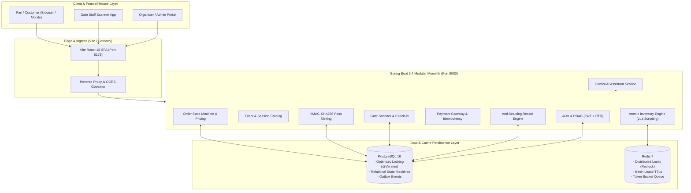

<div align="center">

# ⚡ EventPulse

### Intelligent Event Commerce & Real-Time Operations Platform

[](https://openjdk.org/)
[](https://spring.io/projects/spring-boot)
[](https://react.dev/)
[](https://www.typescript.org/)
[](https://vitejs.dev/)
[](https://www.postgresql.org/)
[](https://redis.io/)
[](https://ai.google.dev/)
[](https://www.docker.com/)
[](LICENSE)

<p align="center">
  <b>EventPulse</b> is a production-grade, enterprise event ticketing and live operations platform designed for high-concurrency ticket drops, atomic seat holds, idempotent checkout, digital cryptographic passes, fail-safe offline gate scanning, and AI-assisted event discovery.
</p>

[Key Features](#-key-features) •
[Architecture](#-system-architecture) •
[Quickstart](#-quickstart--local-development) •
[API Docs](#-api-specification--documentation) •
[Demo Accounts](#-pre-configured-demo-accounts) •
[Security](#-security--compliance)

</div>

---

## 🌟 Overview

Modern live-event ticketing platforms break down at extreme concurrency: ticket bots hoard inventory, race conditions trigger catastrophic double-bookings, scalpers gouge fans on secondary markets, and gate scanners stall when arena cell towers saturate.

**EventPulse** solves these foundational challenges through:
1. **Zero Double-Booking Guarantee:** 2-phase seat reservation combining Redis distributed locks (Lua scripts) with database optimistic locking (`@Version`).
2. **Controlled Virtual Waiting Room:** Token-bucket traffic governor buffering high-velocity on-sales and issuing time-limited cryptographic Admission Tokens via Server-Sent Events (SSE).
3. **Verified Fan-to-Fan Resale Marketplace:** Scalper-proof secondary exchange enforcing a strict rule: `resalePrice <= originalPrice`. On purchase, previous barcodes are invalidated atomically and tamper-proof HMAC credentials are issued to the buyer.
4. **Sub-150ms Gate Check-in:** Real-time QR validation with cryptographic HMAC-SHA256 signature verification and offline-first synchronization for stadium environments.
5. **AI Assistant ("Jarvis"):** Conversational event discovery, smart ticket recommendations, and contextual guidance powered by Google Gemini 2.5.

---

## 🚀 Key Features

### 🎟️ High-Concurrency Booking & Atomic Holds
- **2-Phase Reservation Protocol:** Immediate Redis hold lease with an 8-minute countdown timer, backed by atomic database state machine transitions.
- **Auto-Expiration Scheduler:** Distributed TTL expiration worker that releases unpurchased held inventory back to the general pool automatically.
- **Idempotent Checkout:** Transactions require unique `Idempotency-Key` headers, eliminating duplicate charges or double ticket issuances.

### 🏟️ Visual 2D Seating Designer & Interactive Seat Map
- **SVG-Based Canvas Engine:** Dynamic pan, zoom, and section manipulation for large arenas, tiered auditoriums, and General Admission (GA) standing floors.
- **Real-Time Color-Coded States:**
  - 🟢 **Available:** Ready for selection
  - 🔵 **Selected:** Currently picked by user
  - 🟡 **Held:** Temporarily reserved by another shopper (lease active)
  - ⚪ **Sold:** Permanently issued
  - 🔴 **Blocked:** Organizer hold or reserved seating
  - 🟣 **Resale:** Fan resale pass available at or below face value

### 🔄 Anti-Scalping Fan-to-Fan Resale
- **Strict Cap Enforcement:** Prevents price gouging by rejecting any listing where `resalePrice > originalPrice`.
- **Atomic Ownership Transfer:** Seamless ticket transfer with instant invalidation of the seller's QR code and minting of a brand-new cryptographic pass for the buyer.

### 🏢 Multi-Tenant Organizer Governance & Verification
- **Enterprise Onboarding:** Multi-step organizer verification workflow (`NOT_SUBMITTED` ➔ `PENDING` ➔ `VERIFIED` / `REJECTED`).
- **Gated Publishing:** Organizations cannot publish public ticket sales until documents and banking credentials are reviewed and approved by Platform Administrators.
- **12-Tab Organizer Studio:** Deep operational telemetry including live sales velocity, capacity heatmaps, check-in pacing, and payout statements.

### 📱 Cryptographic Gate Scanner & Pass Wallet
- **In-App Camera Scanner:** Fast QR code decoder with instant server-side signature validation and audio/haptic feedback.
- **Anti-Fraud Replay Protection:** Timestamped cryptographic payload with nonce tracking prevents duplicate scan re-entries or static screenshot fraud.
- **Offline Resilient:** Capable of validating signed HMAC passes even during intermittent network blackouts.

### 🤖 Intelligent Assistant ("Yas")
- **Powered by Google Gemini 2.5 Flash:** Natural language understanding for conversational event discovery, venue accessibility queries, and personalized recommendations.
- **Grounded Responses:** Explains recommendations without hallucinations by grounding answers directly in verified event catalog data.

---

## 🏛️ System Architecture



### 🔒 Two-Phase Atomic Seat Hold Protocol

```
Fan Client                Spring Boot Backend               Redis Cache           PostgreSQL DB
    │                              │                             │                      │
    │ ─── 1. HoldSeatRequest ────> │                             │                      │
    │                              │ ── 2. Run Lua Script ─────> │                      │
    │                              │    (Acquire Lock & Lease)   │                      │
    │                              │ <── 3. Lock Granted (8m) ── │                      │
    │                              │                                                    │
    │                              │ ── 4. Pessimistic / Version Check ───────────────> │
    │                              │ <── 5. Persist HELD State ──────────────────────── │
    │ <── 6. Hold Confirmation ─── │                                                    │
    │     (8-min TTL countdown)    │                                                    │
```

---

## 📁 Repository Structure

```
eventpulse/
├── backend/                       # Spring Boot 3.4.3 Modular Monolith (Java 21/24)
│   ├── src/main/java/com/eventpulse/
│   │   ├── analytics/             # Live ops, revenue charts, gate throughput stats
│   │   ├── assistant/             # Gemini AI integration, voice/text event query parser
│   │   ├── auth/                  # JWT rotation, UserPrincipal, OAuth2, Password reset
│   │   ├── checkin/               # Offline-first gate scanner, duplicate detection
│   │   ├── common/                # RFC 7807 problem details, correlation ID, audit base
│   │   ├── events/                # Event creation wizard, ticket tiers, sessions
│   │   ├── inventory/             # Atomic seat hold engine, Redis Lua scripts, TTL workers
│   │   ├── orders/                # Checkout engine, transparent fee calculators
│   │   ├── organizations/         # Multi-tenant onboarding, verification queue, RBAC
│   │   ├── payments/              # Razorpay integration, test sandbox, webhook verifier
│   │   ├── promotions/            # Coupon validator, percentage & fixed discount limits
│   │   ├── resale/                # Anti-scalping fan resale marketplace & pass re-minting
│   │   ├── ticketing/             # HMAC-SHA256 digital pass generator & wallet
│   │   ├── users/                 # Customer profiles & preferences
│   │   └── venues/                # 2D venue geometry, SVG section layout generator
│   ├── src/main/resources/
│   │   ├── application.yml        # Base configuration & Gemini / Razorpay credentials
│   │   └── application-dev.yml    # Development profile (PostgreSQL & Redis datasource)
│   └── pom.xml                    # Maven dependencies and build lifecycle
│
├── frontend/                      # React 18 + TypeScript + Vite Single Page App
│   ├── src/
│   │   ├── components/            # UI library, 2D SeatMap, EventWizard, Scanner modal
│   │   ├── context/               # AuthContext, AssistantContext, HoldStateContext
│   │   ├── pages/                 # Explore, EventDetail, Checkout, Studio, Wallet, Scanner
│   │   ├── services/              # Axios / Fetch API clients with correlation ID injection
│   │   └── types/                 # Strict TypeScript DTO contracts
│   ├── package.json               # Frontend dependencies (Lucide icons, React Router)
│   └── vite.config.ts             # Dev server config & API proxying
│
├── docker-compose.yml             # Orchestration for PostgreSQL 16 & Redis 7
├── .env.example                   # Environment configuration template
└── README.md                      # Platform documentation
```

---

## ⚡ Quickstart & Local Development

### Prerequisites

Ensure you have installed:
- **Java:** JDK 21 or JDK 24 LTS
- **Maven:** 3.9+
- **Node.js:** v20+ or v24+ & npm 10+
- **Docker:** Docker Engine 24+ & Docker Compose

---

### Step 1: Clone Repository & Setup Environment

```bash
git clone https://github.com/rimi-hash/eventpulse.git
cd eventpulse

# Copy environment variables template
cp .env.example .env
```

---

### Step 2: Launch Database & Cache

Start PostgreSQL 16 and Redis 7 in the background via Docker:

```bash
docker compose up -d
```

Verify services are healthy:
- **PostgreSQL:** `localhost:5433` (DB: `eventpulse_db`, User: `eventpulse_user`)
- **Redis:** `localhost:6379`

---

### Step 3: Run Backend Service

```bash
cd backend
mvn spring-boot:run
```

The Spring Boot backend will initialize database tables, apply seed data, and start on **`http://localhost:8080`**.

- **API Base:** `http://localhost:8080/api/v1`
- **Health Telemetry:** `http://localhost:8080/api/v1/health`
- **Swagger UI:** `http://localhost:8080/swagger-ui.html`
- **OpenAPI Specification:** `http://localhost:8080/v3/api-docs`

---

### Step 4: Run Frontend Application

In a new terminal window:

```bash
cd frontend
npm install
npm run dev
```

The Vite dev server will boot at **`http://localhost:5173`**.

---

## 🎭 Pre-Configured Demo Accounts

EventPulse comes pre-seeded with test accounts across all roles:

| Role | Username / Email | Password | Access Scope |
|---|---|---|---|
| **Platform Administrator** | `sarah@platform.com` (`sarah_admin`) | `Password123!` | Global oversight, organizer verification review, system audit |
| **Organizer Owner** | `vikram@events.com` (`vikram_malhotra`) | `Password123!` | Organizer Studio, Event Creation Wizard, Venue Designer, Telemetry |
| **Check-in Gate Staff** | `marcus@gate.eventpulse.io` (`marcus_gate`) | `Password123!` | High-speed mobile gate scanner, ticket validation |
| **Customer / Attendee** | `priya@eventpulse.io` (`priyasharma`) | `Password123!` | Seat reservation, checkout, pass wallet, fan resale marketplace |

---

## 🧪 Testing Suite

EventPulse features end-to-end integration tests verifying high-concurrency seat holding, optimistic version locking, anti-scalping limits, and organizer approval workflows:

```bash
cd backend
mvn test
```

### Key Integration Tests Included:
- **`PlatformBusinessRulesIntegrationTest`**: Validates anti-scalping invariant (`resalePrice <= originalPrice`), single-use coupon constraints, and idempotent payment processing.
- **`OrganizerApplicationWorkflowIntegrationTest`**: Tests the complete lifecycle from onboarding submission to administrator approval and event publishing.

---

## 📖 API Specification & Documentation

EventPulse implements RESTful conventions with RFC 7807 problem details error envelopes and correlation IDs:

| Endpoint | Method | Description | Auth Required |
|---|---|---|---|
| `/api/v1/auth/login` | `POST` | Authenticate customer/organizer and receive JWT pair | Public |
| `/api/v1/auth/register` | `POST` | Register new customer account | Public |
| `/api/v1/events` | `GET` | List published events with search, category & city filters | Public |
| `/api/v1/events/{id}` | `GET` | Get detailed event metadata, sessions, and ticket tiers | Public |
| `/api/v1/venues/{id}/layout` | `GET` | Retrieve 2D seat map geometry and seat statuses | Public |
| `/api/v1/inventory/hold` | `POST` | Atomically reserve seats with 8-minute Redis lock lease | Customer |
| `/api/v1/orders` | `POST` | Create order with dynamic fees and coupon discount | Customer |
| `/api/v1/payments/verify` | `POST` | Settle payment with HMAC-SHA256 signature verification | Customer |
| `/api/v1/tickets/my-tickets` | `GET` | Fetch user's digital pass wallet with HMAC QR codes | Customer |
| `/api/v1/resale/listings` | `POST` | List ticket on resale marketplace (anti-scalping enforced) | Customer |
| `/api/v1/checkin/scan` | `POST` | Gate scanner validation & duplicate entry detection | Gate Staff |
| `/api/v1/assistant/chat` | `POST` | Gemini AI conversational assistance & recommendations | Public / Auth |

Interactive Swagger documentation is accessible at `http://localhost:8080/swagger-ui.html`.

---

## 🔐 Security & Compliance

- **Authentication & Token Rotation:** Short-lived JWT access tokens (15 mins) paired with cryptographic Refresh Token Rotation (RTR).
- **Cryptographic Passes:** Tickets use an HMAC-SHA256 digital signature over `(ticketId, eventId, holderId, issueTimestamp)` to prevent counterfeiting or tampering.
- **Anti-Scalping Protection:** Enforced at the service layer; resale tickets can never exceed the initial purchase price.
- **Idempotency Guarantee:** Sensitive order mutations require an `Idempotency-Key` header with cached authoritative response playback.
- **OWASP Hardening:** Parameterized queries via Spring Data JPA, BCrypt password hashing (cost 12), and strict CORS origin controls.

---

## 📄 License

This project is licensed under the [MIT License](LICENSE).

---

<div align="center">
  <sub>Built with ❤️ by <a href="https://github.com/rimi-hash">rimi-hash</a></sub>
</div>
